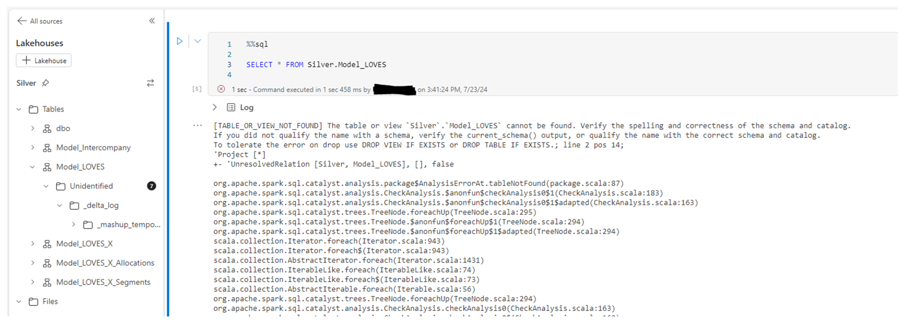

# Ús de la plataforma de dades a Microsoft Fabric

> **Guia metodològica** · AOC
> Com utilitzar Fabric, les àrees de treball i la connexió al Lakehouse Gold.

## Índex

1. [Què és Microsoft Fabric](#1-què-és-microsoft-fabric)
   - [Una plataforma de dades unificada](#una-plataforma-de-dades-unificada)
   - [Components clau](#components-clau)
2. [Accés a la plataforma](#2-accés-a-la-plataforma)
   - [Com ingressar a la plataforma](#com-ingressar-a-la-plataforma)
   - [Com iniciar sessió](#com-iniciar-sessió)
3. [Àrees de treball](#3-àrees-de-treball)
   - [Els nostres espais de treball](#els-nostres-espais-de-treball)
   - [Espais de treball propis per a entitats](#espais-de-treball-propis-per-a-entitats)
4. [Connexió al Lakehouse Gold](#4-connexió-al-lakehouse-gold)
   - [Connexió des de dins de Fabric](#connexió-des-de-dins-de-fabric)
   - [Exemple: consultar el Lakehouse des d'un notebook Spark](#exemple-consultar-el-lakehouse-des-dun-notebook-spark)
   - [Connexió des de fora de Fabric](#connexió-des-de-fora-de-fabric)
   - [Connexió des de fora de Fabric — Python](#connexió-des-de-fora-de-fabric--python)
   - [Connexió des de fora de Fabric — SQL i eines BI](#connexió-des-de-fora-de-fabric--sql-i-eines-bi)
5. [Bones pràctiques](#5-bones-pràctiques)


| Secció | Contingut |
|---|---|
| 01 · Què és Microsoft Fabric | Concepte i components clau de la plataforma |
| 02 · Accés a la plataforma | Com entrar i navegar pels espais de treball |
| 03 · Àrees de treball | bronze_silver, gold, workflows i pd_reports |
| 04 · Connexió al Lakehouse Gold | Des de dins i des de fora de Fabric |

---

## 1. Què és Microsoft Fabric

### Una plataforma de dades unificada

Microsoft Fabric és la plataforma d'analítica de dades que fem servir per centralitzar la ingesta, el processament, l'emmagatzematge i l'explotació de les dades de l'organització. Integra en un sol entorn les eines d'enginyeria de dades, ciència de dades, data warehousing i business intelligence, totes construïdes sobre un mateix llac de dades (OneLake).

- **Un sol llac de dades.** Fabric permet crear un Data Lake anomenat OneLake, que permet treballar amb dades estructurades i no estructurades.
- **Extrem a extrem.** Des de la ingesta fins al report final, dins d'una mateixa plataforma.
- **Governança centralitzada.** Permisos, llinatge i seguretat gestionats de forma unificada.

> En aquesta guia veurem els components més rellevants que utilitzem, com accedir-hi, les àrees de treball disponibles i com connectar-nos al Lakehouse de Gold.

### Components clau

Els blocs de construcció bàsics dins de Fabric.

**Lakehouse**
- Emmagatzematge de dades estructurades i no estructurades sobre OneLake.
- Base de les capes Bronze, Silver i Gold.
- Accessible via Spark, SQL i eines externes.

**Pipelines**
- Orquestren i automatitzen la ingesta i transformació de dades.
- Permeten planificar execucions periòdiques (schedules).
- Es troben a l'espai de treball `workflows`.

**Notebooks**
- Entorns de codi (PySpark, Spark SQL, Python).
- Construeixen la lògica de Bronze → Silver → Gold.
- Orquestrables des d'un pipeline o de forma manual.

**Models semàntics**
- Capa de modelatge (mesures, relacions, jerarquies) sobre Gold.
- Fan de pont entre el Lakehouse i els informes.
- Centralitzen definicions de negoci.

**Informes**
- Informes i quadres de comandament de Power BI.
- Es publiquen a l'espai de treball `pd_reports`.
- Permeten autoservei d'analítica.

**Data Agents**
- Assistents conversacionals sobre les dades, en llenguatge natural.
- S'alimenten dels models semàntics i del Lakehouse Gold.
- Faciliten l'accés a usuaris no tècnics.

---

## 2. Accés a la plataforma

### Com ingressar a la plataforma

Passos per accedir a Microsoft Fabric.

1. **Accedeix a l'URL de Fabric.** Obre `app.fabric.microsoft.com` o accedeix des de Power BI amb el commutador "Fabric".
2. **Inicia sessió amb el compte corporatiu.** Fes servir les credencials corporatives (Microsoft Entra ID / SSO).
3. **Selecciona l'espai de treball.** Al menú lateral "Workspaces", tria l'àrea de treball que necessites.
4. **Comprova els teus permisos.** Si no veus una àrea de treball, sol·licita accés a l'equip de dades.

### Com iniciar sessió

Dues formes de connectar-se i explotar les dades.

**Des de dins de Fabric**
- Accedeix a `app.fabric.microsoft.com`.
- Inicia sessió amb el compte corporatiu AOTEC.
- Un cop dins, selecciona l'àrea de treball a la qual vulguis accedir (`bronze_silver`, `gold`, `workflows` o `pd_reports`).
- Des d'allà pots començar a treballar directament amb les dades ja existents o crear nous components: notebooks, pipelines, SQL analytics endpoint, models semàntics i informes.

**Des de fora de Fabric**
- Connexió mitjançant el SQL Analytics Endpoint del Lakehouse.
- Amb el compte corporatiu AOTEC (autenticació interactiva / SSO).
- O amb un Service Principal proporcionat per l'equip de dades, per a connexions automatitzades o aplicacions.

---

## 3. Àrees de treball

### Els nostres espais de treball

Quatre workspaces, un únic flux de dades:

`bronze_silver` → `gold` → `workflows` → `pd_reports`

| Workspace | Conté | Ús principal |
|---|---|---|
| `bronze_silver` | Lakehouses Bronze i Silver | Ingesta en brut i dades validades/netejades |
| `gold` | Lakehouse Gold | Dades modelades, agregades i llestes per analítica |
| `workflows` | Pipelines | Orquestració i planificació dels processos ETL/ELT |
| `pd_reports` | Informes i models semàntics | Consum final: dashboards i autoservei |

### Espais de treball propis per a entitats

Flexibilitat per créixer més enllà de l'entorn estàndard.

Si una entitat ho necessita, AOC pot proporcionar-li un espai de treball propi dins de Fabric, separat dels workspaces estàndard (`bronze_silver`, `gold`, `workflows`, `pd_reports`). Aquest espai permet a l'entitat crear els seus propis objectes i consumir dades tant del Lakehouse de Gold d'AOC com de fonts externes pròpies, mantenint sempre els seus permisos i governança separats de la resta de la plataforma.

**Crear els seus objectes**
- Lakehouses, notebooks i pipelines propis.
- Models semàntics i informes de Power BI adaptats a les seves necessitats.

**Consumir dades diverses**
- Dades del Lakehouse de Gold d'AOC.
- Dades de fonts externes pròpies de l'entitat.

**Aïllament i governança**
- Espai de treball separat de l'estàndard.
- Permisos i governança propis de l'entitat.

---

## 4. Connexió al Lakehouse Gold

### Connexió des de dins de Fabric

Consumir el Lakehouse Gold dins la mateixa plataforma.

**Notebooks (Spark)**
- Afegeix el Lakehouse gold com a origen de dades del notebook (Add Lakehouse).
- Llegeix les taules directament amb Spark: `spark.read.table(nom_taula)`.
- També es pot fer servir Spark SQL sobre les taules del Lakehouse.

**SQL Analytics Endpoint**
- Cada Lakehouse exposa un punt d'accés SQL de només lectura.
- Des de la vista SQL analytics endpoint es poden llançar consultes T-SQL.
- Ideal per a validacions ràpides o consultes ad-hoc.

**Models semàntics i Power BI**
- Crea un model semàntic (Direct Lake) directament sobre el Lakehouse gold.
- Els informes de `pd_reports` es connecten a aquest model.
- Direct Lake evita còpies de dades i manté els informes actualitzats.

### Exemple: consultar el Lakehouse des d'un notebook Spark

Des d'un notebook de Spark s'adjunta el Lakehouse (Add Lakehouse) i les seves taules queden disponibles directament amb `spark.sql()` o cel·les `%%sql`, sense gestionar rutes ni credencials. En aquest exemple la consulta falla amb `TABLE_OR_VIEW_NOT_FOUND` perquè la carpeta `Model_LOVES` apareix com a “Unidentified”: té `_delta_log` però Fabric no l'ha registrat com a taula Delta vàlida al metastore. Ser visible a l'explorador de fitxers no és el mateix que estar registrada com a taula consultable per SQL.



*Captura d'un notebook de Fabric amb l'error `TABLE_OR_VIEW_NOT_FOUND` sobre `Silver.Model_LOVES`.*

### Connexió des de fora de Fabric

Obtenir la cadena de connexió del Lakehouse Gold.

**SQL Analytics Endpoint**
1. Obre l'espai de treball gold i entra al Lakehouse.
2. Ves a la vista SQL analytics endpoint.
3. A Configuració (Settings), copia l'endpoint SQL de connexió.
4. Fes servir aquest endpoint amb el client, driver o llibreria que necessitis (Python, SSMS, Power BI Desktop, etc.).

**Dades necessàries per connectar**

| Dada | Valor |
|---|---|
| Servidor | Endpoint SQL del Lakehouse gold (`xxxxx.datawarehouse.fabric.microsoft.com`) |
| Base de dades | Nom del Lakehouse gold |
| Autenticació | Microsoft Entra ID (SSO) amb el compte corporatiu |
| Port | 1433 (TDS/SQL estàndard) |

### Connexió des de fora de Fabric — Python

Exemple amb `pyodbc` i autenticació Entra ID.

**Requisits previs**
- Instal·lar el driver ODBC 18 de SQL Server.
- Instal·lar les llibreries: `pip install pyodbc`
- Tenir permisos concedits sobre el Lakehouse gold.

```python
import pyodbc

server   = "xxxxx.datawarehouse.fabric.microsoft.com"
database = "gold"

conn_str = (
    "Driver={ODBC Driver 18 for SQL Server};"
    f"Server={server},1433;Database={database};"
    "Authentication=ActiveDirectoryInteractive;"
    "Encrypt=yes;TrustServerCertificate=no;"
)

conn = pyodbc.connect(conn_str)
df = pd.read_sql("SELECT * FROM dbo.taula_exemple", conn)
```

> **Nota:** també es pot utilitzar la llibreria `semantic-link-sempy` des de dins d'un notebook de Fabric per llegir el Lakehouse sense gestionar credencials manualment.

### Connexió des de fora de Fabric — SQL i eines BI

SSMS, Azure Data Studio i Power BI Desktop.

**SSMS / Azure Data Studio**
- Crea una connexió nova de tipus SQL Server.
- Servidor: endpoint SQL del Lakehouse gold.
- Autenticació: Microsoft Entra ID - MFA.
- Un cop connectat, es poden explorar i consultar les taules com en qualsevol base SQL.

**Power BI Desktop**
- Obtenir dades → SQL Server (o connector de Fabric Lakehouse).
- Introdueix l'endpoint SQL com a servidor.
- Selecciona mode Import o DirectQuery segons el cas d'ús.
- Autentica't amb el compte corporatiu.

**Altres clients (JDBC/ODBC)**
- Qualsevol eina compatible amb SQL Server pot connectar-se via JDBC/ODBC.
- Cal el driver corresponent i suport per a Entra ID.
- Útil per a eines de tercers, ETL externs o scripts en altres llenguatges.

---

## 5. Bones pràctiques

Recomanacions per treballar amb la plataforma.

- **Respecta el model per capes.** No escriguis directament a gold; les dades hi arriben transformades des de `bronze_silver`.
- **Orquestra amb pipelines.** Evita executar processos manualment en producció; usa workflows per planificar-los.
- **Sol·licita només els permisos necessaris.** Demana accés de lectura al Lakehouse gold llevat que el teu rol requereixi més.
- **Documenta i valida.** Comprova la qualitat de les dades i documenta els canvis rellevants als notebooks.

---

