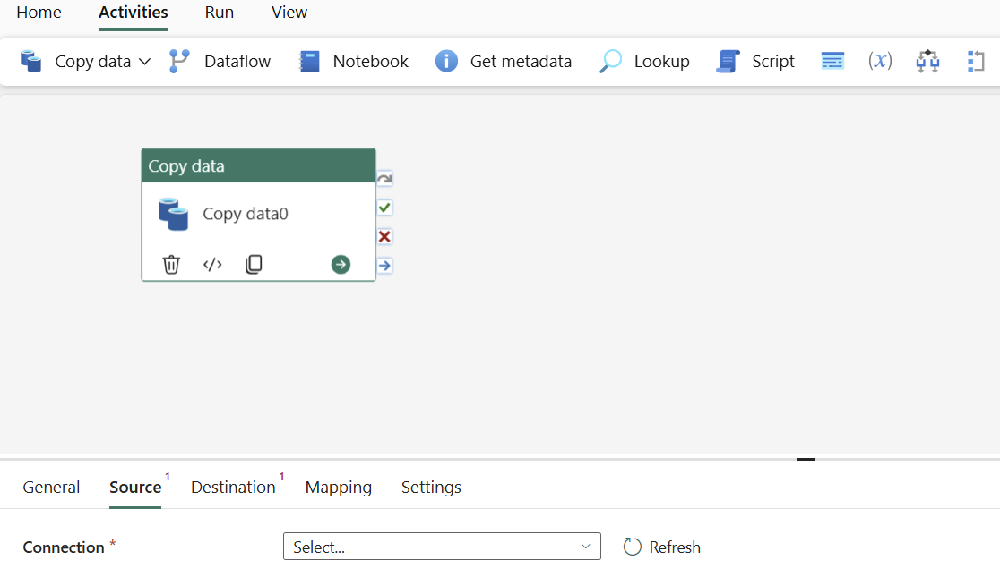
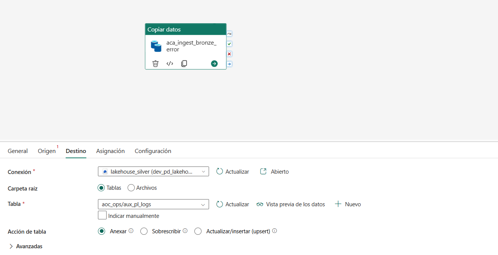
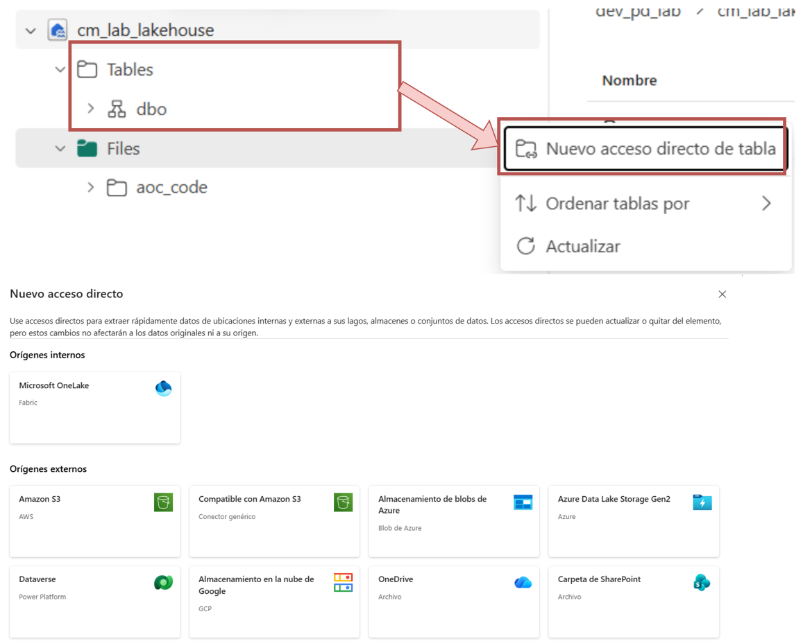

# Com explotar dades des d'un espai de treball proporcionat

> **Guia metodològica** · AOC
> Consulta, reutilitza i publica les dades de l'entitat dins de Fabric.

## Índex

1. [Espais de treball proporcionats](#1-espais-de-treball-proporcionats)
   - [Components principals de Fabric](#components-principals-de-fabric)
2. [Ingesta de dades a un Lakehouse](#2-ingesta-de-dades-a-un-lakehouse)
   - [Opcions per ingerir dades](#opcions-per-ingerir-dades)
   - [Recomanat: Pipelines de dades](#recomanat-pipelines-de-dades)
   - [Quin enfocament triar?](#quin-enfocament-triar)
3. [Ingesta mitjançant una capa Landing](#3-ingesta-mitjançant-una-capa-landing)
   - [Què és la capa Landing?](#què-és-la-capa-landing)
   - [Diagrama d'arquitectura](#diagrama-darquitectura)
   - [Dues opcions d'integració](#dues-opcions-dintegració)
   - [Crear un shortcut des de la Landing](#crear-un-shortcut-des-de-la-landing)
4. [Formes d'explotar les dades](#4-formes-dexplotar-les-dades)
5. [Reutilitzar amb OneLake Shortcut](#5-reutilitzar-amb-onelake-shortcut)
   - [Què és un shortcut?](#què-és-un-shortcut)
   - [Com crear un OneLake Shortcut](#com-crear-un-onelake-shortcut)
   - [Exemple](#exemple)
6. [Consumir-ho un cop enllaçat](#6-consumir-ho-un-cop-enllaçat)
7. [Permisos](#7-permisos)
8. [Annex](#8-annex)
   - [Bones pràctiques](#bones-pràctiques)
   - [Nomenclatura d'espais de treball](#nomenclatura-despais-de-treball)
   - [Nomenclatura a Git](#nomenclatura-a-git)
   - [Nomenclatura d'objectes a Fabric](#nomenclatura-dobjectes-a-fabric)
   - [Nomenclatura del Lakehouse](#nomenclatura-del-lakehouse)
   - [Nomenclatura de taules i camps](#nomenclatura-de-taules-i-camps)
   - [Referències útils](#referències-útils)


| Secció | Contingut |
|---|---|
| 01 · Espais de treball proporcionats | Punt de partida: on resideixen les dades de l'entitat |
| 02 · Ingesta de dades a un Lakehouse | Opcions per incorporar dades des de fonts externes |
| 03 · Ingesta mitjançant una capa Landing | Landing pròpia o governada per AOC, i creació de shortcuts |
| 04 · Formes d'explotar les dades | Consultar, reutilitzar i publicar |
| 05 · Reutilitzar amb OneLake Shortcut | Pas a pas per enllaçar un dataset sense copiar-lo |
| 06 · Consumir-ho un cop enllaçat | Notebooks, SQL endpoint i informes |
| 07 · Permisos | Qui necessita accés a les dades enllaçades |
| 08 · Annex | Bones pràctiques de nomenclatura i referències útils |

---

## 1. Espais de treball proporcionats

El punt de partida per explotar les dades de l'entitat.

Quan és necessari, AOC proporciona a l'entitat un espai de treball propi dins de Fabric. Aquest espai conté el Lakehouse amb les dades pròpies de l'entitat, com per exemple les dades de consum de Datadis. Explotar-les vol dir poder consultar-les, combinar-les amb altres fonts i publicar-les, sense necessitat de moure-les ni duplicar-les fora de l'espai assignat.

- **Dades pròpies, espai propi.** El Lakehouse de l'entitat conté les dades que hi ha carregat, separades de l'entorn estàndard.
- **Explotar no vol dir moure.** Les dades es poden consultar, combinar i publicar sense sortir de l'espai de treball assignat.
- **Governança pròpia.** L'entitat controla els permisos d'accés sobre el seu propi Lakehouse.

> Aquesta guia mostra les diferents formes d'explotar les dades, com reutilitzar-les sense copiar-les mitjançant un OneLake Shortcut, i com consumir-les un cop enllaçades.

### Components principals de Fabric

Les eines que permeten explotar les dades del Lakehouse.

- **Lakehouse:** Permet importar dades d'orígens externs, connectar-se a altres Lakehouses (com per exemple `Lakehouse_Gold`) i crear dades derivades o agregades. Aquest darrer cas pot ser, per exemple, una taula de fets que després es consumeix des de Power BI.
- **Notebooks:** Permeten transformar i processar les dades amb Spark (PySpark, Spark SQL, Python), construint la lògica necessària per generar les dades derivades o agregades del Lakehouse.
- **SQL Analytics Endpoint:** Exposa les taules del Lakehouse per a consulta directa amb T-SQL, sense necessitat d'escriure codi ni obrir un notebook.
- **Models semàntics i informes:** Permeten publicar les dades processades com a informes i quadres de comandament de Power BI, llestos perquè els usuaris finals els explotin.

---

## 2. Ingesta de dades a un Lakehouse

### Opcions per ingerir dades

De la més senzilla a la més avançada.

**Carregar arxius**
- Càrrega directa de fitxers petits des de la màquina local.
- Sense cap transformació.

**Shortcuts**
- Referencien dades d'altres ubicacions (un altre Lakehouse, ADLS Gen2, S3...).
- No es copien les dades.

**Dataflow Gen2**
- Transformació visual amb Power Query.
- Més de 200 connectors, per a volums petits o mitjans.

**Pipelines de dades**
- Eina de còpia escalable, similar a Data Factory.
- Més de 150 connectors. Enfocament recomanat.

**Codi de notebook**
- Control total per programació amb Spark.
- Per a transformacions complexes o orígens no suportats.

**Eventstream**
- Ingesta d'esdeveniments en temps real.
- Escriu directament a taules Delta.

### Recomanat: Pipelines de dades

Per a la majoria d'ingestes des de fonts externes.

Per a la majoria d'ingestes des de fonts externes a la plataforma (APIs, bases de dades SQL Server, Oracle, MySQL, sistemes ERP, etc.), es recomana l'ús de Pipelines de dades, similars a Azure Data Factory, amb més de 150 connectors natius.



*Activitat “Copy data” — pestanya Origen.*



*Activitat “Copy data” — pestanya Destí (Lakehouse Silver).*

Cada activitat Copy data llegeix d'un origen extern i escriu directament a una taula del Lakehouse (Anexar, Sobrescriure o Actualitzar/inserir).

### Quin enfocament triar?

Segons l'escenari d'ingesta.

| Escenari | Enfocament recomanat |
|---|---|
| Fitxers petits des d'una màquina local | **Carregar arxius** |
| Dades de referència sense copiar-les | **Shortcuts** |
| Dades petites/mitjanes amb transformacions visuals | **Dataflow Gen2** |
| Moviment de dades a gran escala | **Pipelines de dades** |
| Transformacions complexes o orígens no suportats | **Codi de notebook** |
| Ingesta d'esdeveniments en temps real | **Eventstream** |
| Streaming d'alt rendiment o de sèries temporals | **Eventstream cap a Eventhouse (OneLake)** |

---

## 3. Ingesta mitjançant una capa Landing

### Què és la capa Landing?

El punt de recepció de les dades abans d'arribar al Lakehouse.

La capa Landing és una zona intermèdia de recepció de dades: el punt on arriben les dades de les integracions abans de ser ingerides al Lakehouse. Pot ser una landing pròpia de l'organisme (per exemple, un compte ADLS, un servidor SFTP...) o, si cal, l'AOC en pot proporcionar una de governada. En qualsevol cas, des de la landing les dades s'incorporen a la plataforma (Bronze/Silver → Gold) sense necessitat de duplicar-les.

- **Landing pròpia de l'organisme.** Comptes ADLS Gen2, servidors SFTP, Blob Storage, SharePoint o altres orígens externs gestionats per l'organisme.
- **Landing Azure AOC (governada).** SFTP gestionat per l'AOC, Blob Storage i Landing a OneLake, amb estàndards i seguretat ja definits.
- **Sense duplicar dades.** En ambdós casos, la incorporació a la plataforma es fa mitjançant OneLake Shortcuts.

> En aquesta secció veurem el diagrama d'arquitectura, com triar entre les dues opcions, i com crear un shortcut per llegir les dades de la landing des de Fabric.

### Diagrama d'arquitectura

Dues rutes per alimentar la Plataforma de Dades corporativa.


*Les fletxes discontínues representen shortcuts: un enllaç lògic sense còpia de dades, cap a un Fabric Workspace governat o no governat.*

### Dues opcions d'integració

Segons el grau de governança i control desitjat.

**Landing de l'organisme (No AOC)**
- Orígens típics: servidors SFTP, Blob Storage, ADLS Gen2, SharePoint, Lakehouse propi o altres (Amazon S3, etc.).
- L'organisme és responsable de la ingesta inicial, la qualitat de les dades en origen i la seguretat dels accessos.
- Recomanada quan l'organisme ja disposa d'una landing madura, o hi ha requisits de sobirania o control del dada.

**Landing Azure AOC (Governada)**
- Components: SFTP gestionat per l'AOC, Azure Blob Storage i Landing a OneLake.
- L'AOC proporciona la infraestructura, els estàndards d'ingesta i la seguretat i governança del dada.
- Recomanada quan es busca alineació amb el model corporatiu, o no existeix una landing prèvia de l'organisme.

### Crear un shortcut des de la Landing

El mateix procediment per a les dues opcions.

1. **Accedeix al Lakehouse Bronze.** Dins de Fabric, obre el Lakehouse Bronze de la plataforma.
2. **Crea un nou table shortcut.** A la secció "Tables", botó dret → "New table shortcut".
3. **Selecciona l'origen.** Tria "Azure Data Lake Gen2" (o l'origen corresponent) i la carpeta amb els fitxers CSV, Parquet o JSON.
4. **Confirma.** Es crea la taula Delta; el shortcut es manté sempre sincronitzat amb l'origen, sense duplicar les dades.

> Documentació detallada amb captures pas a pas al repositori oficial: [github.com/ConsorciAOC/plataforma_dades/…/zona_landing](https://github.com/ConsorciAOC/plataforma_dades/tree/main/microsoft-fabric/integracio_per_pujar_dades/zona_landing)

---

## 4. Formes d'explotar les dades

Segons la necessitat de cada cas, hi ha tres formes d'explotar les dades.

**Consultar-les directament**
- Des d'un notebook amb Spark: `spark.sql()` o `spark.read.table()`.
- Des del SQL analytics endpoint amb consultes T-SQL.
- Ideal per a anàlisis ràpides o exploratòries.

**Reutilitzar-les sense copiar-les**
- Mitjançant un OneLake Shortcut cap a un altre Lakehouse.
- Les dades continuen residint únicament a l'espai d'origen.
- L'altre Lakehouse hi apunta, no en fa cap còpia.

**Publicar-les**
- Crear un model semàntic sobre les taules pròpies.
- Construir informes de Power BI a partir del model.
- Compartir-los amb altres usuaris o departaments.

---

## 5. Reutilitzar amb OneLake Shortcut

### Què és un shortcut?

Un enllaç a OneLake, sense copiar ni moure dades.

Un shortcut és un enllaç dins de OneLake que permet fer visible, dins del Lakehouse propi d'un espai de treball, una taula o carpeta que resideix físicament en un altre lloc, sense necessitat de copiar-la ni moure-la. Un cop creat, es comporta com qualsevol altra taula del Lakehouse: es pot consultar amb Spark, SQL o des d'un model semàntic, tot i que les dades continuen vivint únicament a la seva ubicació d'origen.

- **Cap a un altre Lakehouse dins de Fabric.** Per exemple, per disposar de les taules del `Lakehouse_Gold` d'AOC directament dins del Lakehouse propi, o per enllaçar amb un Lakehouse propietari d'una altra entitat o àrea.
- **Cap a un compte d'emmagatzematge extern a Azure.** Com ADLS Gen2, SharePoint o altres orígens compatibles, per incorporar dades que no resideixen a OneLake sense haver-les d'ingerir prèviament.

> En qualsevol cas, el shortcut manté sempre una única còpia de la veritat: les dades s'actualitzen a l'origen i el canvi es reflecteix automàticament a tots els llocs on s'hi apunta.

### Com crear un OneLake Shortcut

Enllaça un dataset sense copiar-lo.

1. **Obre el Lakehouse destí.** Al workspace on vulguis consumir el dataset, entra al Lakehouse i ves a "Tables" o "Files".
2. **Crea un nou shortcut.** Fes clic amb el botó dret sobre "Tables" i selecciona "Nuevo acceso directo de tabla".
3. **Selecciona l'origen.** Tria "Microsoft OneLake" per enllaçar un altre Lakehouse de Fabric, o un origen extern (ADLS Gen2, S3, SharePoint...).
4. **Confirma i consulta.** El shortcut apareix com si fos una taula local; ja el pots consultar sense haver copiat cap dada.



*Captura real: creació d'un shortcut al Lakehouse.*

### Exemple

Un Lakehouse enllaçat des d'un altre espai de treball.

```text
┌───────────────────────────┐    OneLake Shortcut    ┌───────────────────────────┐
│     Lakehouse d'origen    │ ─────────────────────▶ │       Lakehouse destí     │
│ Workspace de l'entitat ·  │    sense còpia de      │ Workspace on es consumeixen│
│       dades Datadis       │         dades          │         les dades         │
└───────────────────────────┘                        └───────────────────────────┘
```

> El shortcut no duplica les dades: només crea un punter cap a l'origen. Qualsevol canvi al Lakehouse d'origen es reflecteix immediatament al Lakehouse destí, sense sincronitzacions ni còpies manuals.

---

## 6. Consumir-ho un cop enllaçat

Un cop creat el shortcut, funciona com una taula més.

**Notebooks (Spark)**
- El shortcut es veu com una taula més del Lakehouse destí.
- Es consulta amb `spark.read.table()` o Spark SQL, igual que qualsevol altra taula.
- No cal cap configuració addicional.

**SQL Analytics Endpoint**
- Consultable amb T-SQL des del SQL analytics endpoint del Lakehouse destí.
- Útil per a validacions ràpides o consultes ad-hoc.

**Models semàntics i informes**
- Crea un model semàntic (Direct Lake) sobre el Lakehouse destí, incloent les taules enllaçades.
- Els informes reflecteixen sempre les dades actuals de l'origen.

---

## 7. Permisos

Els permisos es gestionen a banda i banda de l'enllaç.

**Permisos sobre l'origen**
- L'entitat propietària controla qui pot llegir les seves dades.
- El shortcut només funciona si l'usuari (o Service Principal) que hi accedeix té permisos de lectura sobre el Lakehouse d'origen.
- Revocar l'accés a l'origen trenca el shortcut per a tothom.

**Permisos sobre el destí (Lakehouse que consumeix)**
- Cal permisos de Contributor o superior per crear el shortcut.
- Un cop creat, qualsevol amb accés de lectura al Lakehouse destí pot consultar les dades enllaçades.
- Documenta l'origen perquè quedi clar d'on vénen les dades.

---

## 8. Annex

### Bones pràctiques

Recomanacions per mantenir-ho endreçat.

- **Evita duplicar dades.** Utilitza shortcuts en lloc de còpies manuals sempre que sigui possible.
- **Documenta l'origen.** Deixa clar on és la font original de cada dataset reutilitzat.
- **Revisa els permisos periòdicament.** Assegura't que només hi té accés qui ho necessita.
- **Nomenclatura consistent.** Fes servir noms clars perquè altres usuaris entenguin d'on vénen les dades.

### Nomenclatura d'espais de treball

Minúscules, sense espais, amb guió baix (`_`) com a separador.

*Codificació: pd = Plataforma de dades · dev = Desenvolupament (prefix de l'entorn de desenvolupament). Microsoft Fabric permet crear fins a 1.000 espais de treball.*

| Workspace (dev) | Workspace (producció) | Contingut |
|---|---|---|
| `dev_pd_lakehouse_bronze_silver` | `pd_lakehouse_bronze_silver` | Lakehouses de les capes Bronze i Silver |
| `dev_pd_lakehouse_gold` | `pd_lakehouse_gold` | Lakehouse de la capa Gold |
| `dev_pd_workflows` | `pd_workflows` | Pipelines per cas d'ús (carpeta per cadascun: via_oberta, valid, etram, hestia...) |
| `dev_pd_workflows_mon_local` | `pd_workflows_mon_local` | Pipelines dels casos d'ús de Mon Local (contractacio, cido...) |
| `dev_pd_reports` | `pd_reports` | Dashboards i informes |

### Nomenclatura a Git

Connexió entre cada espai de treball i el repositori.

*Repositori `plataforma_dades`: inclou `pd_lakehouse_bronze_silver`, `pd_lakehouse_gold`, `pd_workflows` i `pd_reports`. Els casos d'ús de Mon Local viuen en un repositori independent.*

| Workspace | Repositori Git | Carpeta Git | Branca |
|---|---|---|---|
| `dev_pd_lakehouse_bronze_silver` | `plataforma_dades` | `pd_lakehouse_bronze_silver` | `develop` |
| `dev_pd_lakehouse_gold` | `plataforma_dades` | `pd_lakehouse_gold` | `develop` |
| `dev_pd_workflows` | `plataforma_dades` | `pd_workflows` | `develop` |
| `dev_pd_reports` | `plataforma_dades` | `pd_reports` | `develop` |
| `pd_lakehouse_bronze_silver` | `plataforma_dades` | `pd_lakehouse_bronze_silver` | `main` |
| `pd_lakehouse_gold` | `plataforma_dades` | `pd_lakehouse_gold` | `main` |
| `pd_workflows` | `plataforma_dades` | `pd_workflows` | `main` |
| `pd_reports` | `plataforma_dades` | `pd_reports` | `main` |

### Nomenclatura d'objectes a Fabric

Carpetes, notebooks/Spark Jobs i pipelines.

**Carpetes per origen**
- Patró: `[organització]_[nom_font]`
- `aoc_via_oberta`
- `gencat_valid`
- `cido_contractacio`

**Notebooks i Spark Jobs**
- Patró: `[organització]_[servei]_[concepte_negoci]_[part_tècnica]`
- `cido_ddoo_cartipas_bronze_silver`
- `aoc_via_oberta_validacions_bronze_silver`

**Pipelines**
- Patró: `[organització]_[servei]`
- `cido_ddoo`
- `aoc_via_oberta`
- `gencat_valid`

> Convencions generals: sempre en minúscules, sense espais, amb guió baix (`_`) com a separador, amb noms descriptius, concisos i consistents a tota la plataforma.

### Nomenclatura del Lakehouse

Esquemes personalitzats per agrupar taules.

A més de l'esquema per defecte `dbo` (sempre present), Bronze i Silver creen esquemes propis seguint el patró `[organització]_[servei]`:

| Esquema (Bronze / Silver) | Descripció |
|---|---|
| `aoc_via_oberta` | Taules d'Oracle 12 (esquemes siri i pci30iop) de Via Oberta |
| `aoc_global` | Taules d'Oracle 12 (esquema aocglobal) |
| `aoc_valid` | Taules d'AWS RDS PostgreSQL de VALID2 |
| `aoc_etram` | Taules d'Oracle 12 (esquema etram20pci) |
| `cido_ddoo` | Taules de l'API de CIDO |
| `gencat_ddoo` | Taules de PSCP GenCat |
| `aoc_enotum` | Taules d'AWS RDS PostgreSQL d'ENOTUM |

> La nomenclatura de la capa Gold encara està en definició (es valoren opcions com `via_oberta_serveisaoc` o `valid2`, segons el cas d'ús).

### Nomenclatura de taules i camps

Taules en minúscules (`dim_xxxx`) · camps en MAJÚSCULES (`IDE_ANY_CONVOC`).

| Prefix | Tipus de taula |
|---|---|
| `DIM` | Dimensió |
| `FAC` | Taula de fets |
| `AGG` | Agregació d'una taula de fets |
| `REL` | Relació entre dues dimensions |
| `LKP` | Lookup / diccionari |
| `SUK` | Clau subrogada |
| `AUX` | Taula auxiliar (pas intermedi) |
| `REF` | Dades de referència |
| `MES` | Taula mestra |
| `OUT` | Resultats d'un procés o model |
| `FTR` | Features per a un model de ML |

| Prefix | Tipus de camp |
|---|---|
| `IDE` | Identificador |
| `DAT` | Data (precisió dia) |
| `HRS` | Data i hora |
| `TMS` | Timestamp / marca de temps |
| `DES` | Descripció |
| `FLG` | Booleà / flag |
| `IMP` | Import (+ sufix moneda) |
| `NUM` | Indicador numèric |
| `PER` | Percentatge |
| `URL` | Adreça web |
| `GEO` | Geolocalització |
| `ARR` | Array / llista de valors |

### Referències útils

Documentació de referència, interna i oficial de Microsoft.

| Categoria | Recurs | Enllaç |
|---|---|---|
| AOC | Integració amb la capa Landing | [`…/integracio_per_pujar_dades/zona_landing`](https://github.com/ConsorciAOC/plataforma_dades/tree/main/microsoft-fabric/integracio_per_pujar_dades/zona_landing) |
| AOC | Exemple de consulta amb Power BI | [`…/integracio_per_consultar_dades/exemples/powerbi`](https://github.com/ConsorciAOC/plataforma_dades/tree/main/microsoft-fabric/integracio_per_consultar_dades/exemples/powerbi) |
| AOC | Exemple de connexió amb SQL Server | [`…/integracio_per_consultar_dades/exemples/sqlserver`](https://github.com/ConsorciAOC/plataforma_dades/tree/main/microsoft-fabric/integracio_per_consultar_dades/exemples/sqlserver) |
| Microsoft | Què és un Lakehouse | [`…/data-engineering/lakehouse-overview`](https://learn.microsoft.com/en-us/fabric/data-engineering/lakehouse-overview) |
| Microsoft | Opcions d'ingesta a un Lakehouse | [`…/data-engineering/load-data-lakehouse`](https://learn.microsoft.com/en-us/fabric/data-engineering/load-data-lakehouse) |
| Microsoft | OneLake Shortcuts | [`…/onelake/onelake-shortcuts`](https://learn.microsoft.com/en-us/fabric/onelake/onelake-shortcuts) |
| Microsoft | Pipelines de dades (Data Factory) | [`…/data-factory/pipeline-overview`](https://learn.microsoft.com/en-us/fabric/data-factory/pipeline-overview) |
| Microsoft | Dataflow Gen2 | [`…/data-factory/dataflows-gen2-overview`](https://learn.microsoft.com/en-us/fabric/data-factory/dataflows-gen2-overview) |
| Microsoft | Notebooks a Fabric | [`…/data-engineering/how-to-use-notebook`](https://learn.microsoft.com/en-us/fabric/data-engineering/how-to-use-notebook) |
| Microsoft | SQL Analytics Endpoint | [`…/data-engineering/lakehouse-sql-analytics-endpoint`](https://learn.microsoft.com/en-us/fabric/data-engineering/lakehouse-sql-analytics-endpoint) |
| Microsoft | Direct Lake (models semàntics) | [`…/fundamentals/direct-lake-overview`](https://learn.microsoft.com/en-us/fabric/fundamentals/direct-lake-overview) |
| Microsoft | Rols i permisos al Lakehouse | [`…/data-engineering/workspace-roles-lakehouse`](https://learn.microsoft.com/en-us/fabric/data-engineering/workspace-roles-lakehouse) |

---


